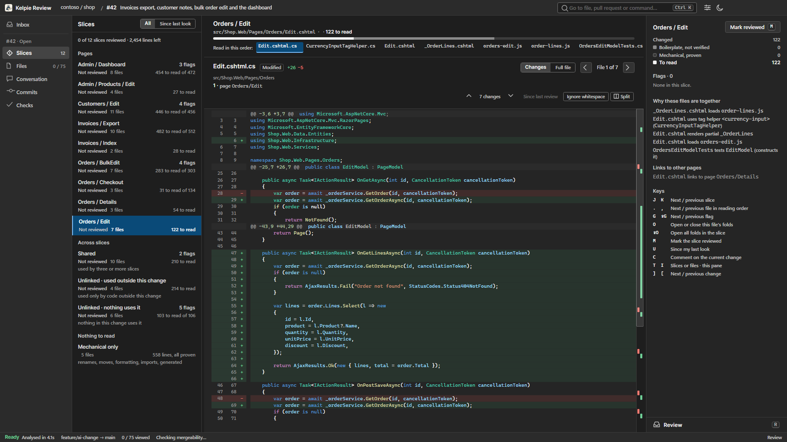

<p align="center"></p>

# Kelpie Review

**Shrink a big pull request to what you actually have to read**, and present it as feature slices, inline in the diff.

Kelpie Review (formerly Lumen) is a desktop pull-request review tool for large, often AI-generated changes. It folds
what it can *prove* is mechanical, summarises a short list of boilerplate shapes, groups the rest by the entry point it
belongs to (a Razor page, a controller, a hosted service), and writes deterministic red flags next to the line they are
about. There are no rankings, scores or AI services: the analysis is static and runs on your machine. The code,
solution and executable keep the `Lumen` name for now.

Design and plan: [docs/overhaul.md](docs/overhaul.md) · History: [docs/plan-v2.md](docs/plan-v2.md),
[docs/review-triage-plan.md](docs/review-triage-plan.md) (superseded)

It is also a whole review client: an **inbox** of the pull requests waiting on you, the PR's conversation, commits and
checks, comments on any line (single or multi-line, with suggestions) gathered into a **pending review** you submit as
Comment / Approve / Request changes, existing threads inline in the diff, split view, whitespace toggle and find in
diff. Local branches (an agent's output before there is a pull request) open the same way, read-only.



More screenshots, dark and light: [docs/screenshots/overhaul](docs/screenshots/overhaul).

## Run it

Prerequisites: .NET 10 SDK, Git, and the GitHub CLI signed in (`gh auth login`).

```bash
dotnet build Lumen.slnx
```

```bash
src/Lumen.App/bin/Debug/net10.0/Lumen.exe --pr https://github.com/KhaiStimpson/andrew-crm/pull/58
```

Or start `Lumen.exe` with no arguments: the home screen is the **inbox** (review requested, your own, and
watched repositories, with unread and new-since-your-last-visit marks), refreshed in the background. Paste a pull request URL (or `owner/repo#123`) into the go-to box
(`Ctrl+K`) to open anything else. A clone's folder opens it as a local branch: `C:\work\shop` (working tree
against the default branch), `C:\work\shop@feature/x` or `C:\work\shop@feature/x..develop`; it is read with
`git show` and a private index, so your working tree and index are never touched. Repositories to watch beyond your own requests are under **Settings → Inbox**.

The app starts the review engine (`engine/Lumen.Engine.exe` next to it) as a separate process and talks to it
over a per-user named pipe with gRPC. The engine keeps a blobless clone and a worktree per PR head under
`%LOCALAPPDATA%\Lumen` and exits when the app does. Engine logs: `%LOCALAPPDATA%\Lumen\logs\engine.log`.

### Useful flags

| Flag | Effect |
|---|---|
| `--pr <url or owner/repo#n>` | Open a pull request on start |
| `--fixture tests/fixtures/andrew-crm-58` | Replay a recorded session instead of GitHub (no network) |
| `--fixture tests/fixtures/razor-pages-app-pr --pr contoso/shop#42` | The synthetic Razor Pages change, sliced and flagged |
| `--fixture tests/fixtures/razor-pages-app-local` | The same change as a local branch, after a follow-up commit (open it from the inbox) |
| `--theme Light\|Dark` | Force a theme (default follows the OS; toggle in the title bar) |
| `--reduced-motion` | Reduced-motion equivalents for every transition (also follows the OS setting) |
| `--capture <dir> --capture-script slice,fold,flag,dark` | Render states to PNGs and exit (design review without a human) |

### Settings

The **Settings** overlay (sliders button in the title bar):

- **Inbox**: repositories to watch, whose open pull requests join the inbox.
- **Files**: paths treated as mechanical (folded as proven, like generated code) and paths that never raise a red
  flag, for all repositories or the open pull request's repository.
- **Appearance**: theme and motion.

Global settings live in `%LOCALAPPDATA%\Lumen\settings.json`, a repository's overrides in
`%LOCALAPPDATA%\Lumen\review\{owner}\{repo}.json`. Settings from the removed AI features are dropped from
`settings.json` on start, and the credentials they stored in Windows Credential Manager are deleted. A settings change
applies to the next analysis: a **Re-analyse** button appears instead of the open pull request re-running on its own.

### Keyboard

The overhaul's keys were checked against the bindings that already existed (`F`, `L`, `K` and `Space` were taken).

| Key | |
|---|---|
| `J` / `K` | Next / previous slice |
| `.` / `,` | Next / previous file in the slice's reading order (on into the next slice) |
| `G` / `Shift+G` | Next / previous red flag |
| `O` | Open or close the current file's folds |
| `Shift+O` | Open every fold in the slice |
| `M` | Mark the slice reviewed (says what's still open first; press again to confirm) |
| `U` | Since my last look |
| `T` | Slices or the file tree |
| `I` | Show or hide the right pane |
| `C` | Comment on the current change (`Ctrl+Enter` adds to the review, `Ctrl+Shift+Enter` posts now) |
| Gutter `+`, drag or shift-click | Comment on a line or a range of lines ("Suggest change" pre-fills a suggestion) |
| `Esc` | Cancel a comment, close find or the tray |
| `N` / `Shift+N` | Next / previous review thread |
| `]` / `[` | Next / previous change in the file, then on into the next / previous file |
| `R` | Review tray: pending comments, summary, Comment / Approve / Request changes (pull requests only) |
| `S` | Split / unified diff |
| `W` | Ignore whitespace |
| `X` | Full file / diff only |
| `Ctrl+F` | Find in diff (`Enter` / `Shift+Enter` next / previous) |
| `Ctrl+K`, `F` | Command palette: files, pull requests, actions |

The diff's scrollbar is a map of the file: removed lines on the left, added lines on the right, flags, threads, drafts
and find matches on top. Click a mark to jump to it; hover it to see its lines. A file that was only moved or renamed
shows the path change ("Moved without changes") instead of a diff; a rename with edits shows just the edits.

Posting anything always requires an explicit click or key; nothing is sent to GitHub otherwise, and a review stays
pending until you submit it.

## Projects

| Project | Role |
|---|---|
| `Lumen.App` | Avalonia 12 desktop client: diff editor (AvaloniaEdit), slices, folds, flags, motion |
| `Lumen.Engine` | Local daemon: sessions, event log with replay, gRPC service on a named pipe |
| `Lumen.Contracts` | `review_engine.proto` and the pipe/socket channel factory |
| `Lumen.Domain` | Review targets, pull requests, diffs, folds; unified diff parser; ports |
| `Lumen.Analysis` | Fold pipeline seams and the mechanical file classifier |
| `Lumen.Roslyn` | Mechanical proofs (rename, move, formatting, imports, comments, ripple, migrations), boilerplate folds, the link resolver and slicer, red-flag detectors |
| `Lumen.GitHub` | REST and GraphQL client (inbox, details, threads, pending reviews, Viewed) and `gh` token source |
| `Lumen.Repository` | git CLI: blobless clone, PR fetch, merge-base, worktrees, diff; read-only local clones |
| `Lumen.Storage` | SQLite: visits, folds, reviewed marks and cache, keyed by review target |

## Tests

```bash
dotnet test Lumen.slnx
```

Opt-in suites that touch the network or a local clone:

| Variable | Test |
|---|---|
| `LUMEN_LIVE_PR=owner/repo#n` | Full engine against real GitHub (read-only) |
| `LUMEN_LIVE_PR` + `LUMEN_RECORD_FIXTURE=<dir>` | Re-record a UI fixture |
| `LUMEN_LIVE_PENDING_PR=owner/repo#n` | Creates and deletes a pending review on a scratch PR (never submits) — run only on a PR you own |
| `LUMEN_TRIAGE_SWEEP=<local clone>` | Prints every proven-mechanical and boilerplate fold and every red flag over the clone's recent commits, for a hand-read safety sweep (local git only) |
| `LUMEN_SLICE_REPLAY=<clone>\|<base>\|<head>` | Opens a local branch through the engine and prints its slices, flags and timings (local git only) |
| `LUMEN_RECORD_RAZOR=<tests/fixtures>` | Re-records the Razor Pages fixtures through the engine (no network) |
| `LUMEN_SLICE_PROBE=1` | Prints the fixture's link graph, for reading by hand |

## Part of Kelpie

Kelpie is a family of developer tools that read the hard stuff and tell you plainly: Dumps · Plans · SQL · Review · Recon.
